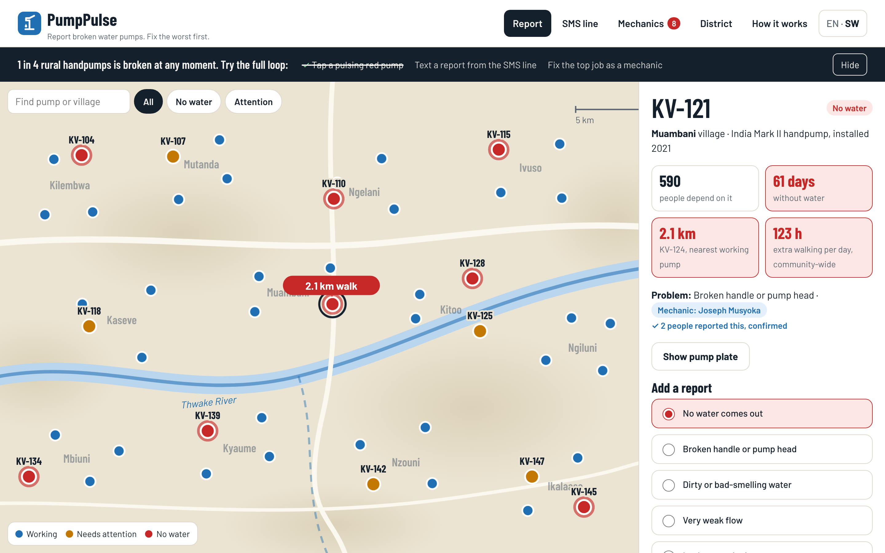

# PumpPulse 💧

**Report broken water points anywhere on Earth by tap or SMS, and fix them in order of human cost.**
Built for the Acodemic × KeebsforWater Global SDG Hackathon · SDG 6 (Clean Water and Sanitation)

**Live demo:** https://soubu.github.io/pumppulse/

🎬 Demo video: `PumpPulse-demo.mp4` (84 s)

## The problem
More than 184 million people in rural sub-Saharan Africa rely on handpumps. Roughly one in four of those pumps is broken at any given time (Foster et al., 2020). Most breakdowns are cheap to fix. They stay broken because of an information gap: nobody tells the mechanic, nobody knows which breakdown hurts most, and families (mostly women and girls) walk kilometres to the next working pump while they wait.

## What PumpPulse does
| Feature | What it does |
|---|---|
| **Any place on Earth** | Search a town (e.g. Ranau, Sabah) or use your location. Real wells, taps, springs, gravity intakes and tanks load from OpenStreetMap; missing ones can be added with a tap. Status starts as "not yet reported". |
| **Google Maps links** | Open any water point in Google Maps, plus walking directions to the nearest working one. No API key needed. |
| **Live district map** | Every pump appears as a dot. Broken pumps pulse, and tapping one shows the walk to the nearest working pump. |
| **One-tap reporting** | Report what's wrong in seconds, or confirm "It works ✓" so the map stays trustworthy. |
| **SMS line** | Works from any basic phone. Text the plate number and the problem in English *or Kiswahili*: `KV-112 BROKEN`, `KV-112 MAJI MACHAFU`, `KV-112 STATUS`, `HELP`. |
| **Impact-ranked repair queue** | Priority = people served × distance to the nearest working pump × days down × severity. Contaminated water ranks higher. Mechanics take jobs and log the part they replaced. |
| **District dashboard** | Shows uptime trend, people cut off, walking hours lost per day, median repair time, parts that fail most, and villages worst first. |
| **Repair-time simulator** | Drag average repair time from 30 days to 3 (the result of the Oxford Smart Handpumps trial in Kenya) and see people without water drop. Calibrated to 1 in 4 pumps broken. |
| **Report confidence** | A single report is flagged as unconfirmed; two or more make it confirmed. |
| **Pump ID plates** | Generates a printable plate per pump with SMS instructions in English and Kiswahili. |
| **3 languages** | English, Bahasa Melayu and Kiswahili, picked automatically from the country you load. The SMS line understands all three (`ROSAK`, `AIR KOTOR`, `MBOVU`…). |
| **Offline demo district** | A fictional district works with no internet at all; real places need a connection. |

## Tech stack
- HTML5, CSS3 (custom properties, `light-dark()` theming, grid, `:has()`), vanilla JavaScript (ES2020)
- Hand-built SVG map and charts, with no map or chart libraries
- Web Storage API (localStorage) for persistence
- Leaflet 1.9.4 (BSD-2), embedded, for maps
- OpenStreetMap data via the Overpass API (water points) and Nominatim (place search), © OpenStreetMap contributors, ODbL
- Google Maps URLs (deep links, no API key)
- Barlow / Barlow Condensed fonts (SIL OFL, via @fontsource), embedded as base64
- Hosting: GitHub Pages
- Testing: Playwright + headless Chrome

## Run locally
Open `index.html` in any browser. That's it.

## Deploy (GitHub Pages)
1. Create a public repo called `pumppulse` and upload `index.html`, `README.md` and `screenshots/`.
2. Go to **Settings → Pages → Source: Deploy from a branch → main / root → Save**.
3. Your site will be live at `https://soubu.github.io/pumppulse/` within a minute or two.

## Model assumptions
Households have 5 people and make one extra round trip per day at 4 km/h. Distances are straight-line. Contamination is weighted 1.25×, weak flow 0.5× and leaks 0.4×. **The district, villages and pumps are fictional demo data.**

## Roadmap
- Merge government water-point records (e.g. JBALB Sarawak, Water Point Data Exchange) with OSM
- Connect the SMS line to a gateway such as Africa's Talking
- Shared database (e.g. Supabase) so all users see the same live data
- Predictive maintenance from repair history

## Sources
- Foster, T., Furey, S., Banks, B., Willetts, J. (2020). *Functionality of handpump water supplies: a review of data from sub-Saharan Africa and the Asia-Pacific region.* Int. J. Water Resources Development 36(5).
- WHO/UNICEF JMP (2025). *Progress on household drinking water, sanitation and hygiene 2000–2024.*
- UKRI / University of Oxford. *Smart Handpump data helps deliver reliable drinking water* (repair time reduced from 30 days to under 3).
